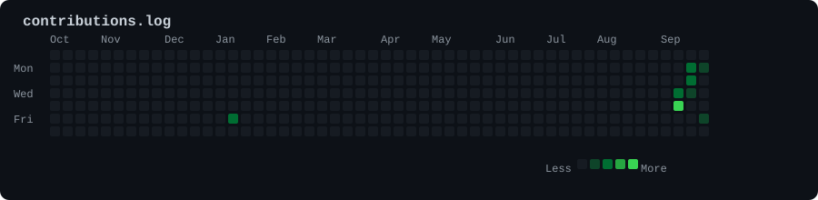

<div align="center">



</div>

<br>

<div align="center">



</div>

<br>

```text
+--------------------------------------------------------------+
|                         arghya@github                        |
+--------------------------------------------------------------+
|                                                              |
|  > Student & Developer                                       |
|  > Building web experiences and full-stack projects          |
|  > Learning - Building - Improving                           |
|                                                              |
|  $ whoami                                                    |
|  Arghya Maji                                                 |
|                                                              |
|  $ skills                                                    |
|  C - Java - Python - JavaScript                              |
|  HTML - CSS - React - Node.js - Express                      |
|  MySQL - MongoDB                                             |
|                                                              |
|  $ interests                                                 |
|  Web Development - Full Stack                                |
|                                                              |
+--------------------------------------------------------------+
```

<div align="center">

### `>_ Thanks for visiting`

</div>
